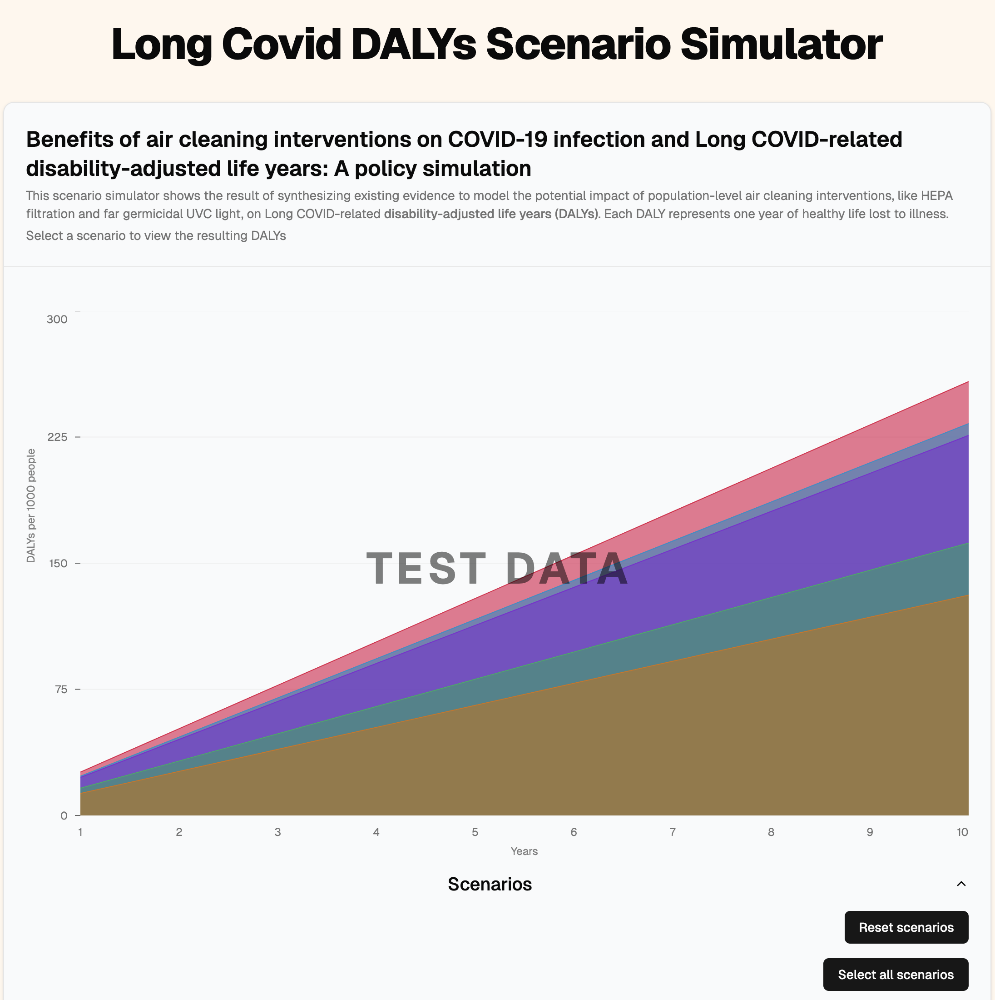

Interactive scientific data visualization web app built with React, TypeScript, and Vite.

[PolyBio](https://polybio.org/) is one of the leading research organizations working towards a cure for Long COVID (and other infection-associated chronic illnesses such as ME/CFS).

Partnered with University of California, San Francisco and Scripps Research, health researchers are creating a data model that will determine how much disease burden can be eased in the future if HEPA filters or far UVC lights are installed in public buildings. The funders of this project wanted a user-friendly way for policymakers to interact with the different scenarios of this project.

I interviewed stakeholders, determined requirements, and built a project that allows users to visualize different scenarios and the resulting disease burden of Long COVID.

## Links

View live site at this link:

::link{url="https://longcoviddalys.netlify.app/"}

Source code:

::link{url="https://github.com/DevinCLane/long-covid-dalys"}
